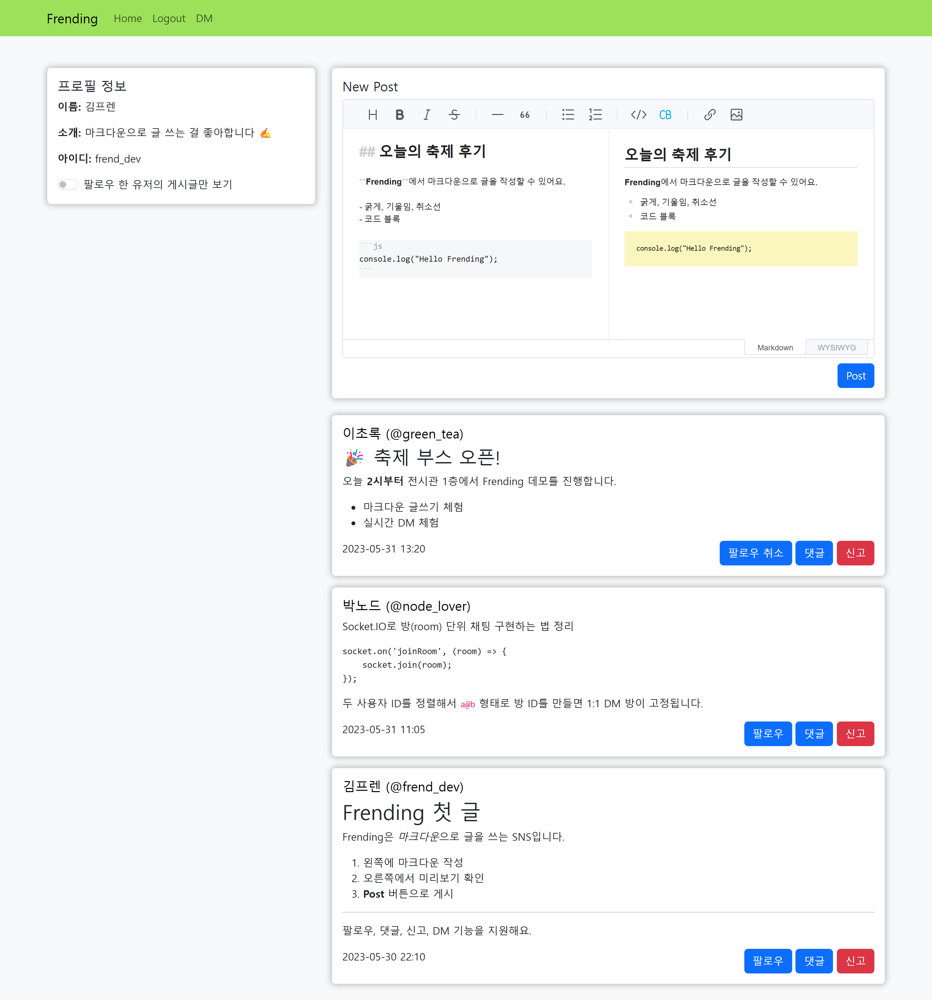
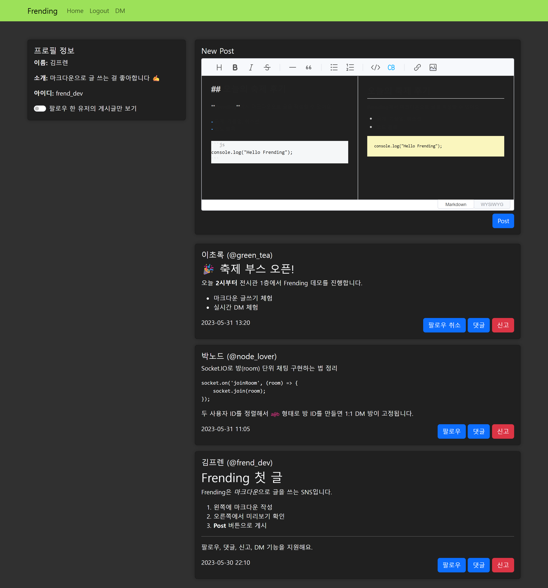
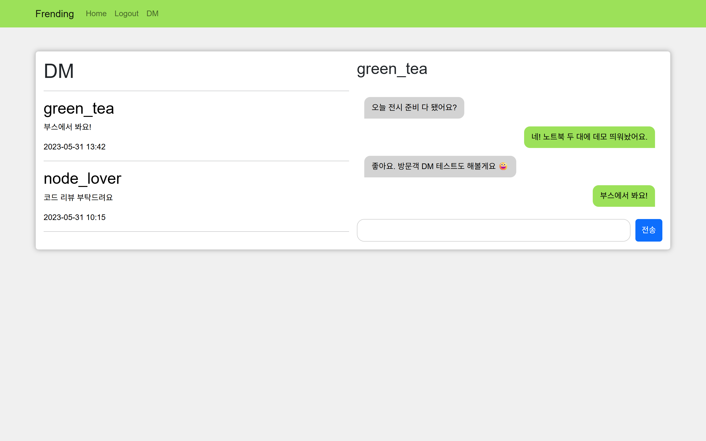
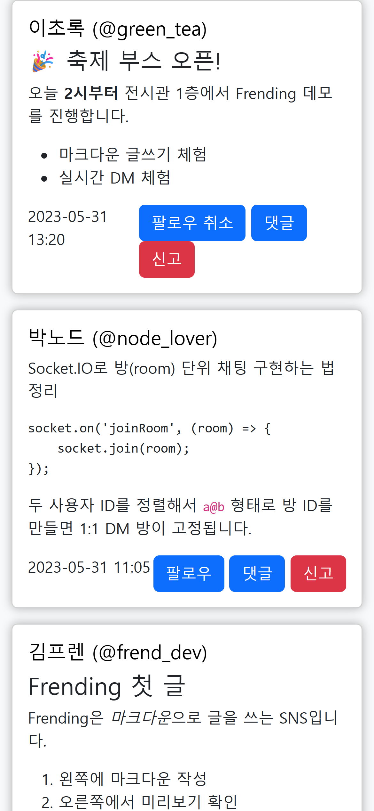

# Frending — 마크다운 SNS (개선 브랜치)

> 이 문서는 `feat/sqlite-local-server` 브랜치의 작업 내용을 설명합니다.
> 2023년 학교 축제 전시용으로 만든 캡스톤 프로젝트를, 누구나 로컬에서 바로 실행할 수 있도록 재구성하고 보안·의존성·버그를 개선했습니다.



## 프로젝트 소개

- 마크다운으로 글을 쓰는 SNS (Toast UI Editor 미리보기)
- 게시글·댓글·팔로우·신고, Socket.IO 기반 1:1 실시간 DM
- 스택: Node.js, Express, Socket.IO, EJS, Bootstrap, SQLite

원본은 축제 10일 전에 급하게 만들어 MSSQL 서버와 저장 프로시저에 의존했고, DB 스키마가 저장소에 없어 저장소만으로는 실행할 수 없었습니다. 보안 대처도 간소한 상태였습니다.

## 이번 브랜치에서 한 작업

### 1. 로컬 실행 구성 (MSSQL → SQLite)

| 이전 | 이후 |
|---|---|
| 외부 MSSQL 서버와 접속정보(`config.js`) 필요 | Node 내장 `node:sqlite` 사용, 별도 DB 설치 없음 |
| 저장 프로시저 정의가 저장소에 없음 | `db.js`에 스키마 자동 생성, 기존 프로시저와 같은 이름의 함수로 대체 |
| 비밀번호 저장 방식 불명 | scrypt + salt 해시로 저장 |
| 실행·종료 방법 없음 | `npm start` / Ctrl+C 정상 종료, `npm run seed` 데모 데이터 |

### 2. 보안 취약점 수정

- **인증 누락**: 글·댓글·팔로우·신고·업로드 API를 비로그인으로 호출할 수 있던 문제 → 로그인 확인(401)
- **DM 발신자 위조·열람**: 클라이언트가 보낸 닉네임을 그대로 믿고, 아무 방에나 접속 가능 → Socket.IO에 세션을 연결해 발신자를 세션 사용자로 고정하고 대화방 참여자만 입장·조회·전송
- **XSS**: 댓글을 이스케이프 없이 `innerHTML`로 출력 → 이스케이프 처리, DM 상대 이름은 `textContent`, DM 경로의 아이디 형식 검증
- **세션**: `Math.random` 비밀키 → `crypto` 난수(또는 `SESSION_SECRET`), 로그인 시 세션 ID 재발급, 쿠키 `httpOnly`·`sameSite=lax`
- **업로드**: 사용자 파일명의 확장자를 그대로 저장, 크기 제한이 동작하지 않음 → MIME 기준 확장자(jpg/png/gif/webp), `limits`로 20MB 제한, 이미지로 읽히지 않는 파일 삭제
- **입력 검증**: 타입·길이 검증, 게시글 조회 개수 상한(100)

### 3. 의존성 업데이트

`npm audit` 취약점 **34건 → 0건**

| 패키지 | 이전 | 이후 |
|---|---|---|
| multer | 1.4.5-lts.1 | 2.5 |
| sharp | 0.32 | 0.35 |
| ejs | 3.1 | 7.0 |
| express / socket.io / express-session / sanitize-html | 4.18 / 4.7 / 1.17 / 2.10 | 4.22 / 4.8 / 1.19 / 2.18 |
| mssql | 9.1 | 제거 |

### 4. 버그 수정

- 업로드한 이미지가 화면에 표시되지 않음 (`/uploads` 정적 제공 누락)
- 빈 게시글을 보내면 응답 없이 요청이 멈춤
- 회원가입 시 사용자 이름 대신 아이디 길이를 다시 검사 (이름 최소 2자로 수정)
- 파일 없이 업로드하면 서버 예외, 업로드 오류 시 기본 오류 페이지(스택) 노출
- 글·댓글 작성 직후 목록을 먼저 불러와 새 항목이 빠짐
- 게시글 추가 로딩 조건의 `if (...);` 세미콜론 버그
- 실행 위치에 따라 EJS 템플릿을 찾지 못함
- 에디터 다크 테마 CSS 누락

### 5. 테스트

`node:test` 기반 스모크 테스트 6개. 임시 DB·업로드 폴더로 서버를 띄워 확인합니다.

- 회원가입·로그인·게시글·댓글·팔로우·신고 흐름
- 비로그인 쓰기 API 401, DM 리다이렉트
- 잘못된 입력 400/404
- 이미지 업로드(2048px 축소, 위장 파일 거부, 업로드 이미지 제공)

DM 위조·타인 대화방 조회 차단은 브라우저에서 직접 확인했습니다.

## 실행 방법

Node.js 22.13 이상이 필요합니다.

```bash
npm install
npm run seed   # 데모 데이터 추가 (계정: frend_dev / green_tea / node_lover, 비밀번호: demo1234)
npm start      # http://localhost:3000 에서 실행, Ctrl+C로 종료
npm test       # 스모크 테스트
```

| 환경 변수 | 기본값 | 설명 |
|---|---|---|
| `PORT` | `3000` | 서버 포트 |
| `DB_PATH` | `data/frending.db` | SQLite 파일 경로 |
| `UPLOAD_DIR` | `uploads/` | 업로드 이미지 저장 폴더 |
| `SESSION_SECRET` | 실행 시 무작위 생성 | 지정하면 재시작해도 로그인이 유지됩니다 |

데이터를 초기화하려면 서버를 끈 뒤 `data/` 폴더를 지우고 `npm run seed`를 다시 실행합니다.

## 프로젝트 구조

```
server.js          Express 라우트 + Socket.IO (DM)
db.js              SQLite 스키마와 데이터 함수
scripts/seed.js    데모 데이터
test/              스모크 테스트
public/main.js     메인 화면 클라이언트 로직
*.html, views/     화면 (정적 HTML, DM은 EJS)
images/            포트폴리오용 스크린샷
```

## 스크린샷

| 메인 (다크) | 실시간 DM | 모바일 |
|---|---|---|
|  |  |  |

스크린샷은 모두 가상 데이터로 촬영했습니다.

## 남은 과제

- 로그인 시도 횟수 제한(무차별 대입 방지)
- 게시글 수정·삭제, 신고 누적 시 처리 정책
- 세션 저장소를 메모리에서 DB로 이전 (서버 재시작 시 로그인 유지)
